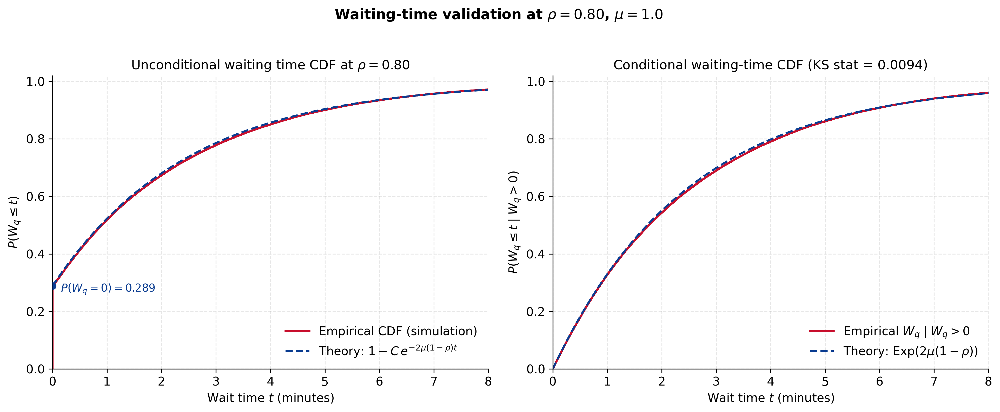

# M/M/2 Two-Cashier Checkout: Theory, Simulation and Validation

A two-cashier checkout modeled as an M/M/2 queue, worked end to end: closed-form stationary distribution and waiting-time distribution, operational checkpoints a manager can act on, a from-scratch discrete-event simulator, and a systematic comparison of simulation against theory. The analysis closes with an M/M/3 staffing rule built from the waiting-time tail.

Graduate term project, MATH 5260 Stochastic Processes, Austin Peay State University, Spring 2026. Sole author: Vaibhav Kedia. Full write-up: [report/MM2_Checkout_Queue_Report.pdf](report/MM2_Checkout_Queue_Report.pdf).



## What is derived

With Poisson arrivals at rate λ, two exponential servers at rate μ each, and traffic intensity ρ = λ / (2μ) < 1:

- Stationary distribution of the number in system, and the expected number in queue and in system, mean waits and utilization.
- Erlang C probability of waiting, which for c = 2 reduces to P(W_q > 0) = 2ρ² / (1 + ρ).
- The full waiting-time distribution: a point mass at zero with weight 1 − C, mixed with an exponential tail, so P(W_q > t) = C · exp(−2μ(1 − ρ)t).
- Operational checkpoints: probability the wait exceeds a threshold, probability the visible line exceeds a length, and how often the system sits in stressed states.
- A staffing rule comparing the largest sustainable arrival rate under two versus three cashiers for several customer tolerance thresholds (M/M/c Erlang C with c = 3).

## Validation design

- Discrete-event simulator with arrival-before-departure tie-breaking.
- Traffic intensities ρ ∈ {0.30, 0.50, 0.70, 0.80, 0.90, 0.95}, μ = 1 per minute.
- 20 independent replications of 200,000 customers each, 10% warm-up discarded, 95% confidence intervals across replications.
- 171 unit and consistency tests on the analytical and simulation code.

## Results

| Check | Result |
| --- | --- |
| Simulation 95% CI contains theory, all 192 (quantity, ρ) pairs | 188 / 192 (97.92%) |
| Of which: performance metrics, Monte Carlo reliable | 95 / 96 |
| Of which: stationary probabilities | 93 / 96 |
| KS distance, conditional waiting time vs Exp(2μ(1 − ρ)) at ρ = 0.80 | D = 0.0094 |
| Unit and consistency tests | 171 / 171 pass |

The scorecard figure (`fig09`) shows the performance metrics only, 102 pairs including 6 rare-event tail probabilities flagged as Monte Carlo unreliable at low ρ, so its pass count differs from the table above by construction.

**Note on the KS test.** The KS statistic is computed on about 128,000 consecutive waits from one replication. Consecutive waits are strongly autocorrelated (lag-1 correlation about 0.93), which violates the independence assumption behind the KS p-value, so `validation.py` prints a p-value that should not be read at face value. The statistic D measures the size of the discrepancy and is small. Thinning the same waits to every 500th observation, where the autocorrelation is essentially zero, gives D = 0.050 with p = 0.52, consistent with the theoretical exponential tail.

## Run it

Tested on Python 3.13.

```bash
pip install -r requirements.txt
cd code
python run_all.py
```

`run_all.py` runs the tests (about 10 s), the validation sweep (about 2 min) and rebuilds all figures (about 15 s). Skip flags: `--skip-tests`, `--skip-validation`, `--skip-plots`.

Individually, from `code/`:

```bash
pytest -q tests/        # 171 tests
python validation.py    # writes CSVs to ../results/
python plots.py         # writes PNGs to ../figures/
```

## Reproducibility

One base seed (`20260422`) with a per-replication offset. Rerunning `validation.py` reproduces every CSV in `results/` byte for byte; this was rechecked on Python 3.13 with the versions pinned in `requirements.txt`.

## Layout

```
code/
  mmc_analytical.py   closed-form M/M/2 and general M/M/c routines
  mmc_simulator.py    discrete-event simulator with confidence intervals
  validation.py       sweep driver, writes CSVs to results/
  plots.py            builds 11 figures from results/ into figures/
  run_all.py          tests, validation and figures in one command
  conftest.py         pytest path setup
  tests/              171 unit and consistency tests
results/              CSV outputs of validation.py
figures/              PNG outputs of plots.py
report/               full project report (PDF)
```

## Next extensions

Erlang A (customer abandonment) and multi-class priority service.

## License

MIT. See [LICENSE](LICENSE).
